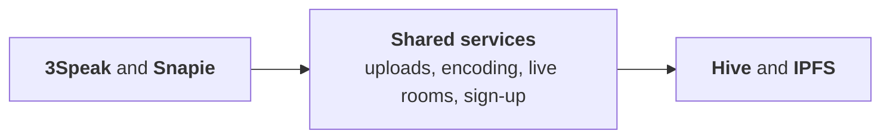

<h1 align="center">Mantequilla Soft</h1>

  <b>Open-source apps for the <a href="https://hive.io">Hive</a> ecosystem.</b> 
  Video, short posts, audio and live rooms.

  <a href="https://3speak.tv">3speak.tv</a> ·
  <a href="https://snapie.io">snapie.io</a> ·
  <a href="https://discord.gg/NSFS2VGj83">Discord</a> ·
  <a href="https://mantequilla-soft.com">mantequilla-soft.com</a>

---

On Hive, every post, vote and tip belongs to the people who made it, not to the app they used. We build apps that make that feel as easy as any other social platform, and we run the infrastructure behind them: upload and encoding services, IPFS storage, live media servers and the account system that gets new people in.

Everything here is open source, and most of it is built so other Hive apps can reuse it.

## What we build

<table>
  <tr>
    <td width="50%" align="center"> <b>3Speak</b>: video</td>
    <td width="50%" align="center"> <b>Snapie</b>: short posts</td>
  </tr>
</table>

### 🎬 3Speak

**[3speak.tv](https://3speak.tv)** is a video platform where creators own their channel and viewers earn.

- Long videos, Shorts, audio and podcasts (with RSS feeds), and live streams and audio rooms (OpenPods)
- A Shorts editor in the browser with a teleprompter that follows your voice, green screen, music and stickers
- Ads where **creators get 50%** of the revenue and **viewers who opt in get 10%**
- Sign up with Google, GitHub, Discord or email through [Butter Auth](https://butrauth.com), with no keys to manage
- Installable as an app on any phone, in 21 languages

Code: [new-3speak-tv](https://github.com/Mantequilla-Soft/new-3speak-tv) · [3speak-player](https://github.com/Mantequilla-Soft/3speak-player) · [3speakchecks](https://github.com/Mantequilla-Soft/3speakchecks)

### ⚡ Snapie

**[snapie.io](https://snapie.io)** is a home for short-form Hive posts (snaps), on the web and on mobile.

- Snaps and blog feeds, community discovery, and voting with live reward estimates
- Real-time chat with public channels, direct messages and group chats
- OpenPods live rooms built in

Code: [snapie-io](https://github.com/Mantequilla-Soft/snapie-io) (web) · [hivesnaps](https://github.com/Mantequilla-Soft/hivesnaps) (React Native app)

## How it fits together

Both apps run on the same shared services, and so can yours:

## Use our building blocks in your app

| Repo | What it gives you |
|---|---|
| [embedvideos](https://github.com/Mantequilla-Soft/embedvideos) | Resumable video uploads, encoding and an embeddable player for any Hive frontend or website |
| [3speak-player](https://github.com/Mantequilla-Soft/3speak-player) | The 3Speak video player as a JavaScript library |
| [snapieaudio](https://github.com/Mantequilla-Soft/snapieaudio) | Audio hosting and a waveform player for voice messages, podcasts and songs |
| [Butter Auth](https://butrauth.com) | "Sign in once. Post everywhere." Let people sign up to your Hive app with Google, GitHub, Discord or email, over standard OAuth 2.0 |
| [hangouts](https://github.com/Mantequilla-Soft/hangouts) | Live audio and video rooms with Hive login, as a server plus a React SDK |
| [hive-master-skill](https://github.com/Mantequilla-Soft/hive-master-skill) | A Claude Code skill that knows Hive development, mined from 40+ production Hive apps |

## Run part of the network

Anyone can help encode 3Speak videos. A community encoder needs FFmpeg and IPFS, picks up jobs on its own, and installs with one command: see [3speakencoder](https://github.com/Mantequilla-Soft/3speakencoder).

## Tools for the Hive community

- [web3-switcher](https://github.com/Mantequilla-Soft/web3-switcher): browser extension to open any Hive post in PeakD, Ecency, Hive.blog or Inleo in one click
- [whosaidwhat](https://github.com/Mantequilla-Soft/whosaidwhat): search Hive conversations
- [hive-vp-monitor](https://github.com/Mantequilla-Soft/hive-vp-monitor): real-time voting power monitor
- [hive-beneficiary-rewards](https://github.com/Mantequilla-Soft/hive-beneficiary-rewards): track beneficiary rewards for any account
- [hivefeedprice](https://github.com/Mantequilla-Soft/hivefeedprice): price feed tool for Hive witnesses
- [myownpage](https://github.com/Mantequilla-Soft/myownpage): a simple website builder with Hive features

## What we work with

React · Vite · Next.js · React Native (Expo) · Node.js · Go · MongoDB · IPFS · FFmpeg · LiveKit · Hive

## Get involved

- **Contribute:** issues and pull requests are welcome on every repo. Look for `good first issue` and `help wanted` labels.
- **Translate:** 3Speak is in 21 languages and translations need no coding. See [TRANSLATING.md](https://github.com/Mantequilla-Soft/new-3speak-tv/blob/develop/TRANSLATING.md).
- **Talk to us:** [Discord](https://discord.gg/NSFS2VGj83) · [@threespeak on Hive](https://ecency.com/@threespeak) · [X](https://x.com/3speaktv)

Built by @menobass, @kesolink, @eddiespino, @tibfox and contributors.

